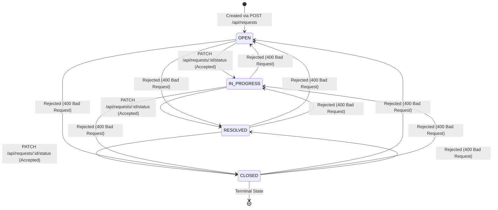

# Service Request Management System — REST API Contract

## 1. Base URL & Protocol Conventions

- **Base Path:** `/api`
- **Protocol:** HTTPS (or HTTP for local development)
- **Data Exchange Format:** `application/json` (both request payload and response body)
- **Character Encoding:** UTF-8
- **Date & Time Format:** ISO-8601 UTC string (e.g., `2026-11-12T10:30:00.000Z`)

### Standard Success Envelope
Successful single-resource operations return the resource object directly with an appropriate status code (`200 OK` or `201 Created`). Collection endpoints return a top-level JSON array with `200 OK`.

### Standard Error Envelope
All error responses across all endpoints follow a uniform structure:

```json
{
  "error": {
    "code": "VALIDATION_ERROR",
    "message": "Human-readable description of what went wrong",
    "details": [
      {
        "field": "title",
        "issue": "Title must be at least 5 characters long"
      }
    ]
  }
}
```

#### Standard Error Codes:
- `VALIDATION_ERROR` (HTTP `400`): Malformed syntax, invalid field lengths, missing required fields, or unsupported enum values.
- `INVALID_STATE_TRANSITION` (HTTP `400`): Attempt to transition a service request to a status not permitted by the lifecycle state machine.
- `INVALID_IDENTIFIER` (HTTP `400`): Provided ID is not a valid RFC-4122 UUID string.
- `RESOURCE_NOT_FOUND` (HTTP `404`): The requested entity ID does not exist in the database.
- `SERVICE_UNAVAILABLE` (HTTP `503`): Backend server is alive but failed downstream connectivity checks (e.g. database pool disconnection).
- `INTERNAL_SERVER_ERROR` (HTTP `500`): Unexpected unhandled runtime exception.

---

## 2. Endpoints Specification

### 2.1 Health Check

#### `GET /api/health`
Verifies backend operational status and database connection health.

- **Request:**
  - Headers: `Accept: application/json`
  - Query Parameters: None
  - Body: None

- **Responses:**
  - **`200 OK` — All systems operational:**
    ```json
    {
      "status": "ok",
      "database": "connected",
      "timestamp": "2026-11-12T10:30:00.000Z"
    }
    ```
  - **`503 Service Unavailable` — Database connection failed:**
    ```json
    {
      "status": "degraded",
      "database": "disconnected",
      "timestamp": "2026-11-12T10:30:00.000Z",
      "error": {
        "code": "SERVICE_UNAVAILABLE",
        "message": "Database ping failed"
      }
    }
    ```

---

### 2.2 Create Service Request

#### `POST /api/requests`
Submits and persists a new service request. Automatically assigns an initial status of `'OPEN'`.

- **Request:**
  - Headers: `Content-Type: application/json`
  - Body:
    ```json
    {
      "title": "Laptop display flickering frequently",
      "description": "External monitor flashes black every few minutes after recent OS update.",
      "category": "IT",
      "priority": "MEDIUM"
    }
    ```
  - **Field Constraints:**
    - `title` *(string, required)*: Minimum 5 characters, maximum 120 characters after trimming whitespace.
    - `description` *(string, required)*: Minimum 10 characters, maximum 2000 characters after trimming whitespace.
    - `category` *(string, required)*: Must be one of `["IT", "Facilities", "Other"]`.
    - `priority` *(string, required)*: Must be one of `["LOW", "MEDIUM", "HIGH"]`.

- **Responses:**
  - **`201 Created` — Request successfully created:**
    ```json
    {
      "id": "7b594b98-1e42-4f36-9b57-69b828ef81c2",
      "title": "Laptop display flickering frequently",
      "description": "External monitor flashes black every few minutes after recent OS update.",
      "category": "IT",
      "priority": "MEDIUM",
      "status": "OPEN",
      "created_at": "2026-11-12T10:30:00.000Z",
      "updated_at": "2026-11-12T10:30:00.000Z"
    }
    ```
  - **`400 Bad Request` — Validation failure:**
    ```json
    {
      "error": {
        "code": "VALIDATION_ERROR",
        "message": "Validation failed for request payload",
        "details": [
          {
            "field": "title",
            "issue": "Title must be at least 5 characters long"
          },
          {
            "field": "category",
            "issue": "Category must be one of: IT, Facilities, Other"
          }
        ]
      }
    }
    ```

---

### 2.3 List Service Requests

#### `GET /api/requests`
Retrieves a list of service requests, ordered by `created_at DESC` (newest first). Supports optional status filtering.

- **Request:**
  - Query Parameters:
    - `status` *(string, optional)*: Filter by lifecycle state. Allowed values: `OPEN`, `IN_PROGRESS`, `RESOLVED`, `CLOSED`.
  - Example: `GET /api/requests?status=OPEN`

- **Responses:**
  - **`200 OK` — Requests retrieved successfully:**
    ```json
    [
      {
        "id": "7b594b98-1e42-4f36-9b57-69b828ef81c2",
        "title": "Laptop display flickering frequently",
        "description": "External monitor flashes black every few minutes after recent OS update.",
        "category": "IT",
        "priority": "MEDIUM",
        "status": "OPEN",
        "created_at": "2026-11-12T10:30:00.000Z",
        "updated_at": "2026-11-12T10:30:00.000Z"
      },
      {
        "id": "2d14cb89-6a31-4e92-a1f9-91334c9c1187",
        "title": "Air conditioning maintenance needed in Room 302",
        "description": "Temperature in Room 302 exceeds 28 degrees Celsius during afternoon hours.",
        "category": "Facilities",
        "priority": "HIGH",
        "status": "OPEN",
        "created_at": "2026-11-12T09:15:00.000Z",
        "updated_at": "2026-11-12T09:15:00.000Z"
      }
    ]
    ```
  - **`200 OK` — No matching records found (Empty State):**
    ```json
    []
    ```
  - **`400 Bad Request` — Invalid status query parameter:**
    ```json
    {
      "error": {
        "code": "VALIDATION_ERROR",
        "message": "Invalid query parameter",
        "details": [
          {
            "field": "status",
            "issue": "Status query parameter must be one of: OPEN, IN_PROGRESS, RESOLVED, CLOSED"
          }
        ]
      }
    }
    ```

---

### 2.4 Get Single Service Request

#### `GET /api/requests/:id`
Retrieves detailed information for a single service request by its unique UUID identifier.

- **Request:**
  - Path Parameters:
    - `id` *(string, required)*: Valid RFC-4122 UUID (e.g. `7b594b98-1e42-4f36-9b57-69b828ef81c2`).

- **Responses:**
  - **`200 OK` — Request found:**
    ```json
    {
      "id": "7b594b98-1e42-4f36-9b57-69b828ef81c2",
      "title": "Laptop display flickering frequently",
      "description": "External monitor flashes black every few minutes after recent OS update.",
      "category": "IT",
      "priority": "MEDIUM",
      "status": "OPEN",
      "created_at": "2026-11-12T10:30:00.000Z",
      "updated_at": "2026-11-12T10:30:00.000Z"
    }
    ```
  - **`400 Bad Request` — Malformed UUID identifier:**
    ```json
    {
      "error": {
        "code": "INVALID_IDENTIFIER",
        "message": "Identifier must be a valid UUID format",
        "details": [
          {
            "field": "id",
            "issue": "Invalid UUID format supplied: 12345"
          }
        ]
      }
    }
    ```
  - **`404 Not Found` — Resource does not exist:**
    ```json
    {
      "error": {
        "code": "RESOURCE_NOT_FOUND",
        "message": "Service request with id '7b594b98-1e42-4f36-9b57-69b828ef81c2' not found",
        "details": []
      }
    }
    ```

---

### 2.5 Update Service Request Status

#### `PATCH /api/requests/:id/status`
Transitions the lifecycle status of an existing request according to the strict state machine rules.

- **Request:**
  - Path Parameters:
    - `id` *(string, required)*: Valid RFC-4122 UUID.
  - Headers: `Content-Type: application/json`
  - Body:
    ```json
    {
      "status": "IN_PROGRESS"
    }
    ```

- **Responses:**
  - **`200 OK` — Status updated successfully:**
    ```json
    {
      "id": "7b594b98-1e42-4f36-9b57-69b828ef81c2",
      "title": "Laptop display flickering frequently",
      "description": "External monitor flashes black every few minutes after recent OS update.",
      "category": "IT",
      "priority": "MEDIUM",
      "status": "IN_PROGRESS",
      "created_at": "2026-11-12T10:30:00.000Z",
      "updated_at": "2026-11-12T10:45:00.000Z"
    }
    ```
  - **`400 Bad Request` — Disallowed status transition:**
    ```json
    {
      "error": {
        "code": "INVALID_STATE_TRANSITION",
        "message": "Cannot transition request from 'OPEN' to 'RESOLVED'. Valid next status is: 'IN_PROGRESS'",
        "details": [
          {
            "current_status": "OPEN",
            "attempted_status": "RESOLVED",
            "allowed_next_statuses": ["IN_PROGRESS"]
          }
        ]
      }
    }
    ```
  - **`400 Bad Request` — Invalid status enum value:**
    ```json
    {
      "error": {
        "code": "VALIDATION_ERROR",
        "message": "Validation failed for request payload",
        "details": [
          {
            "field": "status",
            "issue": "Status must be one of: OPEN, IN_PROGRESS, RESOLVED, CLOSED"
          }
        ]
      }
    }
    ```
  - **`404 Not Found` — Resource does not exist:**
    ```json
    {
      "error": {
        "code": "RESOURCE_NOT_FOUND",
        "message": "Service request with id '7b594b98-1e42-4f36-9b57-69b828ef81c2' not found",
        "details": []
      }
    }
    ```

---

## 3. Allowed Status Transition Matrix

The system enforces a strictly unidirectional, non-skipping state progression model:



### Transition Validation Matrix

| Current Status | Target Status | Transition Allowed? | HTTP Status Code | Reason / Behavior |
| :--- | :--- | :--- | :--- | :--- |
| **`OPEN`** | `IN_PROGRESS` | **YES** | `200 OK` | Support staff begins active work on the ticket. |
| **`OPEN`** | `RESOLVED` | **NO** | `400 Bad Request` | Skipping `IN_PROGRESS` is prohibited; work must be explicitly initiated first. |
| **`OPEN`** | `CLOSED` | **NO** | `400 Bad Request` | Unworked requests cannot be directly closed out. |
| **`OPEN`** | `OPEN` | **NO** | `400 Bad Request` | Redundant transition; request is already in `OPEN` state. |
| **`IN_PROGRESS`** | `RESOLVED` | **YES** | `200 OK` | Operator marks the service issue as fixed/resolved. |
| **`IN_PROGRESS`** | `OPEN` | **NO** | `400 Bad Request` | Backward transition is prohibited to preserve audit continuity. |
| **`IN_PROGRESS`** | `CLOSED` | **NO** | `400 Bad Request` | Skipping `RESOLVED` state is disallowed. |
| **`IN_PROGRESS`** | `IN_PROGRESS` | **NO** | `400 Bad Request` | Redundant transition; request is already in `IN_PROGRESS` state. |
| **`RESOLVED`** | `CLOSED` | **YES** | `200 OK` | Ticket is verified and permanently closed out. |
| **`RESOLVED`** | `OPEN` | **NO** | `400 Bad Request` | Backward transition to initial state is prohibited. |
| **`RESOLVED`** | `IN_PROGRESS` | **NO** | `400 Bad Request` | Reopening resolved tickets is disallowed in MVP workflow. |
| **`RESOLVED`** | `RESOLVED` | **NO** | `400 Bad Request` | Redundant transition; request is already in `RESOLVED` state. |
| **`CLOSED`** | *Any Status* | **NO** | `400 Bad Request` | `CLOSED` is a terminal state. No further status modifications permitted. |
