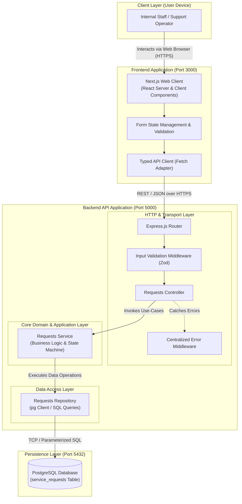
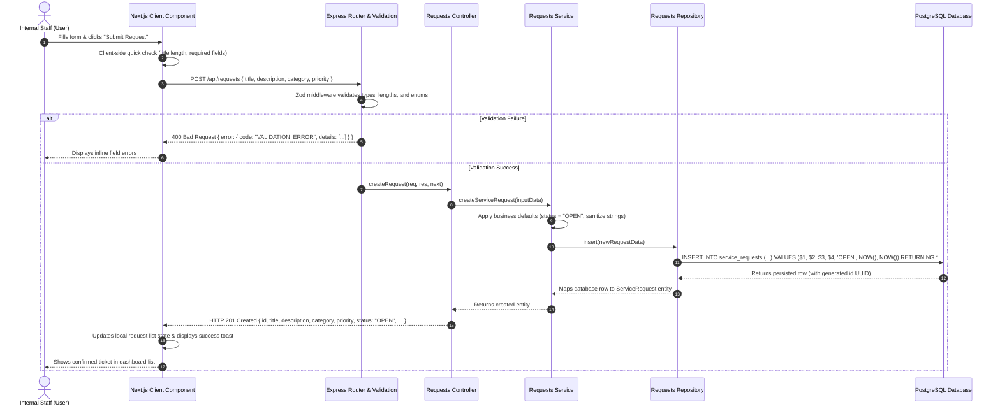

# Service Request Management System — Architecture & System Design

## 1. Architecture Overview & Rationale

The Service Request Management System is architected as a **Modular Monolith** comprising a single Express.js + TypeScript backend application, a standalone Next.js frontend presentation client, and a PostgreSQL relational database.

```
+-------------------------------------------------------------------------------+
|                                  USER AGENT                                   |
|                          Web Browser (Desktop / Mobile)                       |
+-------------------------------------------------------------------------------+
                                      |
                                      | HTTPS (Port 3000)
                                      v
+-------------------------------------------------------------------------------+
|                             NEXT.JS FRONTEND                                  |
|   App Router Pages | React Form State | UI Components | Backend API Client    |
+-------------------------------------------------------------------------------+
                                      |
                                      | HTTPS / JSON (Port 5000)
                                      v
+-------------------------------------------------------------------------------+
|                       EXPRESS.JS BACKEND (MODULAR MONOLITH)                   |
|                                                                               |
|  +-------------------------------------------------------------------------+  |
|  | [1] Routes & Controllers: Route matching, params parsing, status codes |  |
|  +-------------------------------------------------------------------------+  |
|                                      |                                        |
|  +-------------------------------------------------------------------------+  |
|  | [2] Validation & Middleware: Zod schema parsing, CORS, centralized logs |  |
|  +-------------------------------------------------------------------------+  |
|                                      |                                        |
|  +-------------------------------------------------------------------------+  |
|  | [3] Service / Use-Case Layer: Domain invariants, transition workflow   |  |
|  +-------------------------------------------------------------------------+  |
|                                      |                                        |
|  +-------------------------------------------------------------------------+  |
|  | [4] Repository / Data Access Layer: Parameterized SQL, row mapping      |  |
|  +-------------------------------------------------------------------------+  |
+-------------------------------------------------------------------------------+
                                      |
                                      | TCP / Parameterized SQL (Port 5432)
                                      v
+-------------------------------------------------------------------------------+
|                             POSTGRESQL DATABASE                               |
|        Relational Tables | CHECK Constraints | B-Tree Indexes | TIMESTAMPTZ   |
+-------------------------------------------------------------------------------+
```

### Why a Modular Monolith over Microservices?
For the scope of the Service Request Management System (an internal organizational workflow system), a modular monolith was selected based on the following engineering rationales:

1. **Elimination of Distributed Network Overhead:** Microservices introduce inter-service RPC/HTTP latency, network serialization, and partial network failure modes. A modular monolith executes all cross-module function calls in-memory with sub-millisecond overhead.
2. **Operational Simplicity & Single Deployment Pipeline:** Managing multiple container lifecycles, service discovery, distributed tracing, and independent CI/CD pipelines imposes substantial DevOps friction. A modular monolith deploys as a single cohesive unit while preserving clean domain separation in code.
3. **Strong Consistency & Native ACID Transactions:** Ticket lifecycle transitions demand immediate consistency (preventing race conditions or invalid states). PostgreSQL and a monolithic backend provide immediate ACID guarantees without complex distributed transaction patterns (such as Sagas or Two-Phase Commit).
4. **Clean Boundaries with Low Friction:** By enforcing strict internal layering (`Routes` $\rightarrow$ `Controllers` $\rightarrow$ `Services` $\rightarrow$ `Repositories`), the codebase retains high cohesion and loose coupling. If a specific domain boundary ever requires independent scaling in the future, it can be extracted into an independent microservice with minimal refactoring.

---

## 2. Context & Container Architecture Diagram

The system follows the C4 Container model to delineate runtime containers, communication protocols, and execution boundaries.



---

## 3. Layer Responsibilities & Dependency Rules

To guarantee maintainability, testability, and separation of concerns, the following strict dependency boundaries are established:

| Layer | Technology | Primary Responsibilities (Owns) | Architectural Boundary (Must Avoid) |
| :--- | :--- | :--- | :--- |
| **Frontend / UI** | Next.js, React, Tailwind CSS | <ul><li>Renders responsive pages, forms, and tables</li><li>Maintains client-side form input state</li><li>Dispatches API client requests to backend</li><li>Presents loading indicators, empty states, and validation banners</li></ul> | <ul><li>Must NOT hold database connection strings or secrets</li><li>Must NOT be treated as authoritative for business rules</li><li>Must NOT bypass backend API</li></ul> |
| **Controller & Routing** | Express.js Router, Controllers | <ul><li>Maps HTTP methods and URL paths</li><li>Extracts request payloads, params, and query strings</li><li>Invokes schema validation triggers</li><li>Returns correct HTTP status codes (`200`, `201`, `400`, `404`)</li><li>Formats uniform API responses</li></ul> | <ul><li>Must NOT execute business rules or state checks</li><li>Must NOT execute SQL queries directly</li><li>Must NOT manipulate persistence models</li></ul> |
| **Validation & Middleware** | Zod, Express Middleware, Helmet, CORS | <ul><li>Parses and sanitizes request bodies, params, and query strings</li><li>Halts malformed payloads before reaching controllers</li><li>Normalizes application errors into uniform JSON envelopes</li><li>Provides CORS policy enforcement and request logging</li></ul> | <ul><li>Must NOT contain business logic or state machine rules</li><li>Must NOT make database calls directly</li></ul> |
| **Service / Use-Case** | Pure TypeScript Domain Classes / Functions | <ul><li>Encapsulates business rules and workflows</li><li>Enforces strict status lifecycle state machine (`OPEN` $\rightarrow$ `IN_PROGRESS` $\rightarrow$ `RESOLVED` $\rightarrow$ `CLOSED`)</li><li>Coordinates entity transformations</li><li>Determines business-level errors (e.g. invalid transition)</li></ul> | <ul><li>Must NOT access Express `req`, `res`, or `next` objects</li><li>Must NOT format HTTP status codes or JSON bodies</li><li>Must NOT construct raw SQL strings</li></ul> |
| **Repository / Data Access** | Node Postgres (`pg` pool / parameterized SQL) | <ul><li>Executes parameterized SQL queries against PostgreSQL</li><li>Maps database rows to strongly-typed TypeScript domain entities</li><li>Handles database connection pooling and query error propagation</li></ul> | <ul><li>Must NOT enforce domain business validation rules</li><li>Must NOT format data for frontend UI display</li><li>Must NOT handle HTTP concepts</li></ul> |
| **Database** | PostgreSQL 16+ | <ul><li>Guarantees durable ACID persistence on disk</li><li>Enforces relational constraints (PK, NOT NULL, CHECK constraints)</li><li>Maintains B-tree indexes for fast filtering and sorting</li><li>Tracks UTC timestamps (`created_at`, `updated_at`)</li></ul> | <ul><li>Must NOT be exposed directly to public internet or browser</li><li>Must NOT rely solely on application logic for basic constraints</li></ul> |
| **Cross-Cutting Concerns** | Custom middleware, Logger, Config module | <ul><li>Environment variable validation at boot time</li><li>Centralized error handling and unhandled rejection trapping</li><li>Correlation ID tracking and request logging</li></ul> | <ul><li>Must NOT couple directly to a single business domain</li></ul> |

---

## 4. End-to-End Request Flow Walkthrough

Below is the step-by-step trace of a user submitting a service request:



### Detailed Trace Steps:
1. **User Action:** The user fills out the request form in the Next.js frontend (title, description, category dropdown, priority dropdown) and clicks "Submit Request".
2. **Frontend Dispatch:** The React component validates basic constraints locally and invokes the centralized API client helper to send a `POST /api/requests` payload with `Content-Type: application/json`.
3. **Route & Schema Validation:** The request arrives at the Express.js server on `/api/requests`. The Zod validation middleware intercepts the body, trims whitespace, verifies length boundaries (title 5–120 chars, description 10–2000 chars), and checks enum values.
4. **Controller Orchestration:** The `RequestsController.create` handler unpacks the validated payload and calls `RequestsService.create`.
5. **Business Logic Execution:** The `RequestsService` sets the initial lifecycle status strictly to `"OPEN"`, constructs the creation domain command, and forwards it to `RequestsRepository.create`.
6. **Data Persistence:** The `RequestsRepository` executes a parameterized SQL `INSERT` statement via connection pooling (`pg`), generating a UUID via `gen_random_uuid()` and setting `created_at` and `updated_at` to `NOW()`.
7. **Database Confirmation:** PostgreSQL persists the row and returns the created record via the `RETURNING *` clause.
8. **HTTP Response:** The controller receives the domain entity and responds with HTTP `201 Created` containing the complete JSON representation.
9. **UI Update:** The Next.js frontend receives the HTTP 201 payload, closes or clears the submission form, appends the newly created request to the visible dashboard table, and displays a success notification.

---

## 5. Planned Backend Folder Structure

The Express.js backend follows a modular monolith structure organized by domain feature module, maintaining isolation between HTTP handling, business logic, and database persistence.

```
backend/
├── src/
│   ├── app.ts                         # Express app configuration (CORS, JSON parser, routes)
│   ├── server.ts                      # Server entry point (starts listener, checks DB connection)
│   ├── config/
│   │   ├── env.ts                     # Environment variable loading & validation (Zod)
│   │   └── database.ts                # PostgreSQL connection pool configuration
│   ├── database/
│   │   ├── migrations/                # Versioned SQL migration scripts
│   │   └── seeds/                     # Baseline mock/seed data for development
│   ├── middleware/
│   │   ├── errorHandler.ts            # Centralized API error handling middleware
│   │   ├── validateRequest.ts         # Zod schema validation middleware wrapper
│   │   └── requestLogger.ts           # HTTP request logging middleware
│   └── modules/
│       ├── health/
│       │   ├── health.routes.ts       # GET /api/health route definition
│       │   └── health.controller.ts   # Checks database ping & process uptime
│       └── requests/
│           ├── requests.routes.ts     # Route mapping for /api/requests endpoints
│           ├── requests.controller.ts # HTTP request/response orchestration
│           ├── requests.service.ts    # Business logic & state machine validation
│           ├── requests.repository.ts # Parameterized SQL data access layer
│           ├── requests.schema.ts     # Zod schemas for input validation
│           └── requests.types.ts      # TypeScript interfaces, enums, & DTO types
├── tests/
│   ├── unit/                          # Service & state machine unit tests
│   └── integration/                   # Supertest API endpoint integration tests
├── .env.example                       # Template for environment variables
├── package.json
└── tsconfig.json
```

---

## 6. Trade-Offs & Known Risks

### Architectural Trade-Off: Single Deployable Monolith vs. Distributed Components
- **Trade-Off:** Deploying the entire backend as a single deployable unit means that write operations (creating tickets) and read operations (polling/listing tickets) scale together. Read workloads cannot be independently auto-scaled to separate container pools without replicating the entire API service.
- **Justification for Scope:** For an internal organizational service request management system, traffic patterns are predictable (tens to hundreds of requests per hour, not millions of public web hits). A single deployable drastically lowers cloud infrastructure costs, eliminates inter-service serialization latency, simplifies continuous integration, and allows direct database transaction boundaries.

### Known Architectural Risk: Lack of Authentication / RBAC in MVP
- **Risk:** In the MVP release, authentication and Role-Based Access Control (RBAC) are deferred to post-MVP milestones. Any network client capable of reaching the backend API can execute status transitions or create requests.
- **Mitigation Strategy:**
  1. The API is intended exclusively for deployment within an isolated internal corporate network or VPN.
  2. The application enforces strict domain-level state machine validation (`OPEN` $\rightarrow$ `IN_PROGRESS` $\rightarrow$ `RESOLVED` $\rightarrow$ `CLOSED`) on the server. Out-of-order transitions are rejected at the service layer regardless of caller identity, preventing data corruption.
  3. The controller and service boundaries are explicitly designed with modular interfaces so that authentication and authorization middleware (e.g. JWT verification, user identity extraction, and role checks) can be injected cleanly in front of routes in Phase 2 without rewriting core domain services.
