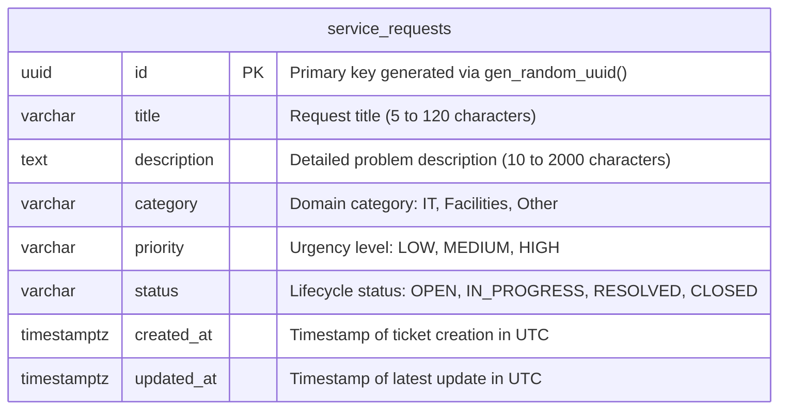

# Service Request Management System — Relational Data Model

## 1. Entity-Relationship Diagram

The Service Request Management System relies on PostgreSQL as its primary relational store. In the MVP scope, the core transactional entity is `service_requests`.



---

## 2. Table Specification: `service_requests`

| Column Name | Data Type | Nullable | Default Value | Constraints & Validation | Description |
| :--- | :--- | :--- | :--- | :--- | :--- |
| `id` | `UUID` | **NO** | `gen_random_uuid()` | `PRIMARY KEY` | Universally unique immutable identifier for each service request. |
| `title` | `VARCHAR(120)` | **NO** | *None* | `CHECK (char_length(trim(title)) >= 5 AND char_length(title) <= 120)` | Concise summary of the issue. Whitespace trimmed; minimum 5 characters, maximum 120 characters. |
| `description` | `TEXT` | **NO** | *None* | `CHECK (char_length(trim(description)) >= 10 AND char_length(description) <= 2000)` | Comprehensive description detailing the problem. Minimum 10 characters, maximum 2000 characters. |
| `category` | `VARCHAR(20)` | **NO** | *None* | `CHECK (category IN ('IT', 'Facilities', 'Other'))` | High-level organizational category defining the responsible operational department. |
| `priority` | `VARCHAR(10)` | **NO** | *None* | `CHECK (priority IN ('LOW', 'MEDIUM', 'HIGH'))` | Relative urgency indicator assigned during ticket creation. |
| `status` | `VARCHAR(20)` | **NO** | `'OPEN'` | `CHECK (status IN ('OPEN', 'IN_PROGRESS', 'RESOLVED', 'CLOSED'))` | Current lifecycle state. Automatically initialized to `'OPEN'`. |
| `created_at` | `TIMESTAMPTZ` | **NO** | `NOW()` | *Immutable audit timestamp* | Server-assigned timestamp marking record creation in UTC. |
| `updated_at` | `TIMESTAMPTZ` | **NO** | `NOW()` | *Updated on every status change* | Server-assigned timestamp tracking when the record was last altered in UTC. |

---

## 3. Constraints, Indexes & Architectural Rationale

### 3.1 Primary Key & Indexing Strategy

1. **Primary Key (`id`):**
   - **Type:** B-Tree index automatically created on `id`.
   - **Rationale:** Ensures $O(\log N)$ lookup performance when retrieving single requests via `GET /api/requests/:id` or executing updates via `PATCH /api/requests/:id/status`. UUIDv4 / random UUID values prevent sequential ID enumeration attacks while allowing distributed ID generation without sequence locks.

2. **Compound Filter & Sort Index (`idx_service_requests_status_created_at`):**
   - **Definition:** `CREATE INDEX idx_service_requests_status_created_at ON service_requests (status, created_at DESC);`
   - **Rationale:** The primary read access pattern for the application is listing requests filtered by status and sorted in descending chronological order (newest first):
     ```sql
     SELECT * FROM service_requests 
     WHERE status = 'OPEN' 
     ORDER BY created_at DESC;
     ```
     This composite index covers both the filter predicate (`status = $1`) and the sorting clause (`ORDER BY created_at DESC`), avoiding expensive in-memory sort operations and full-table scans.

3. **Fallback Sort Index (`idx_service_requests_created_at`):**
   - **Definition:** `CREATE INDEX idx_service_requests_created_at ON service_requests (created_at DESC);`
   - **Rationale:** Optimizes the unfiltered list query (`GET /api/requests` when no `?status=` parameter is supplied), delivering immediate index-scan ordering.

---

### 3.2 Database-Level Defense-in-Depth

The data model enforces integrity at the relational database engine layer, functioning as a second line of defense behind backend application validation (Zod schemas):

- **Enum Values Protection:** Rather than relying solely on TypeScript enums or validation schemas, `CHECK (category IN ('IT', 'Facilities', 'Other'))`, `CHECK (priority IN ('LOW', 'MEDIUM', 'HIGH'))`, and `CHECK (status IN ('OPEN', 'IN_PROGRESS', 'RESOLVED', 'CLOSED'))` guarantee that no external SQL script, migration error, or rogue service can insert unsupported values.
- **String Length and Whitespace Guardrails:** Check constraints (`char_length(trim(title)) >= 5` and `char_length(trim(description)) >= 10`) ensure that blank strings or whitespace-padded inputs are rejected immediately at the database barrier.
- **Audit Field Immutability:** The `created_at` timestamp is initialized once via `NOW()` and is never modified. The `updated_at` column is refreshed upon every status transition to maintain an accurate audit trail of operational interventions.
