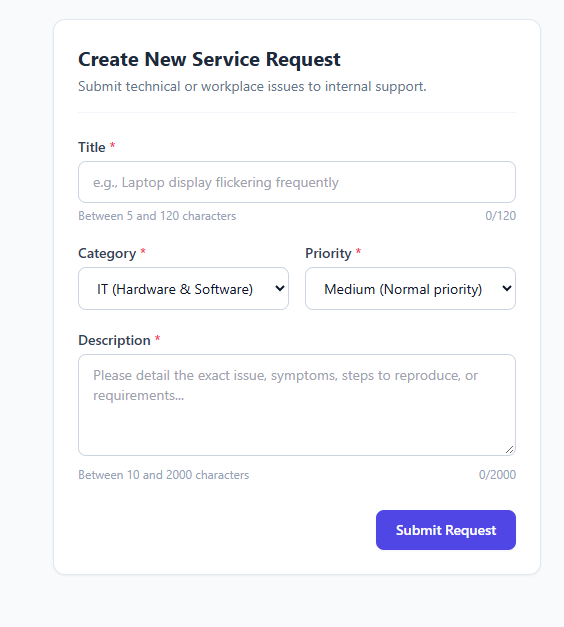
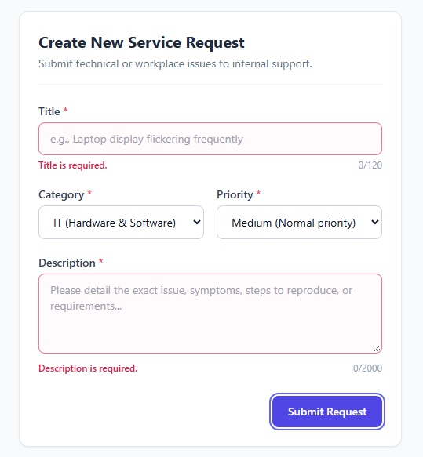
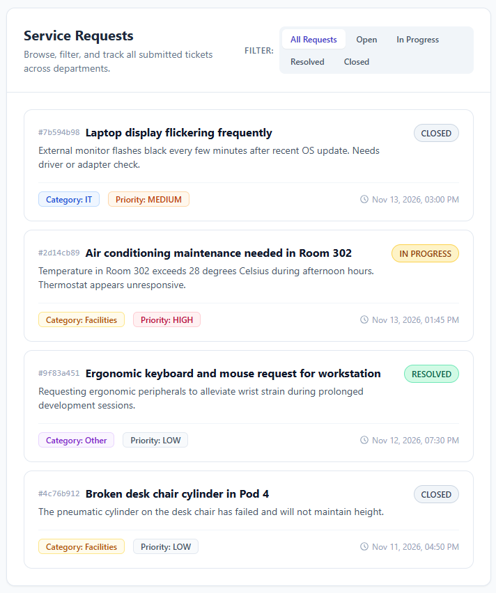
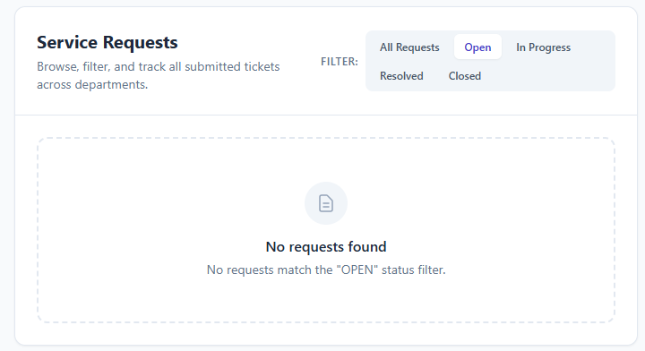

# Day 04 UI Screenshots

This directory contains visual verification screenshots of the Day 04 Frontend UI implementation:

### 1. Create Request Form (Pristine State)
Initial form layout showing required indicators, accessible placeholder text, category/priority selectors, and character limit indicators.

### 2. Form Client-Side Validation Errors
Instant inline validation feedback highlighting required fields when submitted empty or failing character constraints (title: 5–120 chars, description: 10–2000 chars).

### 3. Service Requests List (All Requests)
List view displaying persisted service request cards with identifiers, titles, descriptions, category badges, priority badges, lifecycle status badges, and formatted timestamps.

### 4. Status Filter & Empty State
Context-aware empty state presentation displayed when filtering by a status (e.g. "OPEN") with no matching records.

