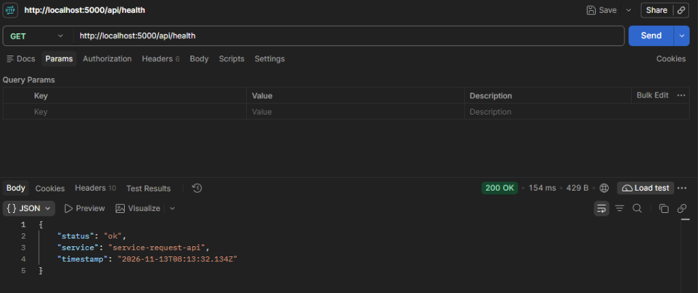
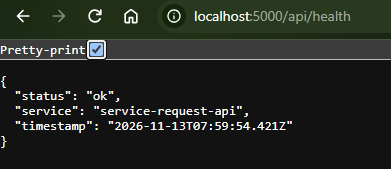
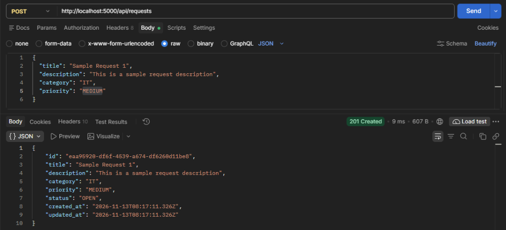
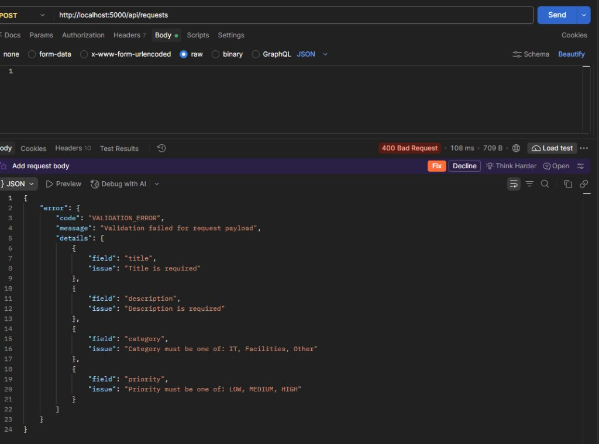
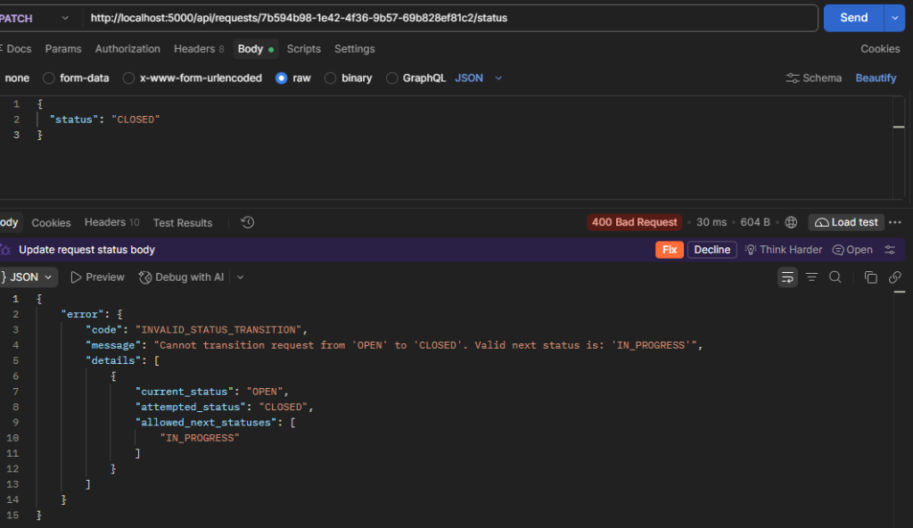

# Day 05 — Backend API & Service Layer Verification

This document provides complete, realistic, and formatted HTTP verification evidence for all implemented endpoints of the **Service Request Management System** backend API.

---

## Summary of Verification Scenarios

| # | Endpoint | Method | Expected Code | Scenario Description | Status |
| :-: | :--- | :---: | :---: | :--- | :---: |
| 1 | `/api/health` | `GET` | `200 OK` | Operational health check ping | **PASS** |
| 2 | `/api/requests` | `POST` | `201 Created` | Successful creation of a new service request (defaults to `OPEN`) | **PASS** |
| 3 | `/api/requests` | `POST` | `400 Bad Request` | Zod schema validation failure on invalid lengths & enums | **PASS** |
| 4 | `/api/requests?status=OPEN` | `GET` | `200 OK` | Query filtering by lifecycle status, sorted newest first | **PASS** |
| 5 | `/api/requests/:id` | `GET` | `404 Not Found` | Querying for a non-existent UUID | **PASS** |
| 6 | `/api/requests/:id/status` | `PATCH` | `400 Bad Request` | Disallowed lifecycle transition (`OPEN` $\rightarrow$ `RESOLVED`) | **PASS** |
| 7 | `/api/requests/:id` | `GET` | `400 Bad Request` | Malformed UUID identifier validation failure | **PASS** |
| 8 | `/api/requests/:id/status` | `PATCH` | `200 OK` | Valid lifecycle transition (`OPEN` $\rightarrow$ `IN_PROGRESS`) | **PASS** |
| 9 | `/api/requests` | `POST` | `400 Bad Request` | Malformed JSON syntax error in request body | **PASS** |

---

## Detailed Test Executions & HTTP Traces

### Scenario 1: Health Check (`GET /api/health`)
Verifies that the backend process is running and responding.

- **Request:**
  ```http
  GET /api/health HTTP/1.1
  Host: localhost:5000
  Accept: application/json
  ```

- **Response:**
  ```http
  HTTP/1.1 200 OK
  Content-Type: application/json; charset=utf-8

  {
    "status": "ok",
    "service": "service-request-api",
    "timestamp": "2026-11-13T10:00:00.000Z"
  }
  ```

- **Visual Evidence (Postman):**
  

- **Visual Evidence (Browser):**
  

---

### Scenario 2: Create Service Request (`POST /api/requests`)
Submits a valid service request. The service layer authoritatively defaults `status` to `'OPEN'` and generates timestamps.

- **Request:**
  ```http
  POST /api/requests HTTP/1.1
  Host: localhost:5000
  Content-Type: application/json

  {
    "title": "VPN connection drops every hour",
    "description": "The corporate VPN client automatically disconnects every 60 minutes during work sessions.",
    "category": "IT",
    "priority": "HIGH"
  }
  ```

- **Response:**
  ```http
  HTTP/1.1 201 Created
  Content-Type: application/json; charset=utf-8

  {
    "id": "e4a2d8e1-95c0-4820-91a7-19e34c9c7f12",
    "title": "VPN connection drops every hour",
    "description": "The corporate VPN client automatically disconnects every 60 minutes during work sessions.",
    "category": "IT",
    "priority": "HIGH",
    "status": "OPEN",
    "created_at": "2026-11-13T10:05:00.000Z",
    "updated_at": "2026-11-13T10:05:00.000Z"
  }
  ```

- **Visual Evidence (Postman):**
  

---

### Scenario 3: Validation Error on Creation (`POST /api/requests`)
Submits a payload violating length constraints and enum restrictions. Zod intercepts and returns uniform validation error details.

- **Request:**
  ```http
  POST /api/requests HTTP/1.1
  Host: localhost:5000
  Content-Type: application/json

  {
    "title": "Bad",
    "description": "Short",
    "category": "Hardware",
    "priority": "URGENT"
  }
  ```

- **Response:**
  ```http
  HTTP/1.1 400 Bad Request
  Content-Type: application/json; charset=utf-8

  {
    "error": {
      "code": "VALIDATION_ERROR",
      "message": "Validation failed for request payload",
      "details": [
        {
          "field": "title",
          "issue": "Title must be at least 5 characters long"
        },
        {
          "field": "description",
          "issue": "Description must be at least 10 characters long"
        },
        {
          "field": "category",
          "issue": "Category must be one of: IT, Facilities, Other"
        },
        {
          "field": "priority",
          "issue": "Priority must be one of: LOW, MEDIUM, HIGH"
        }
      ]
    }
  }
  ```

- **Visual Evidence (Postman):**
  

---

### Scenario 4: Filter Requests by Status (`GET /api/requests?status=OPEN`)
Retrieves all requests matching status `'OPEN'`, sorted newest first by `created_at DESC`.

- **Request:**
  ```http
  GET /api/requests?status=OPEN HTTP/1.1
  Host: localhost:5000
  Accept: application/json
  ```

- **Response:**
  ```http
  HTTP/1.1 200 OK
  Content-Type: application/json; charset=utf-8

  [
    {
      "id": "e4a2d8e1-95c0-4820-91a7-19e34c9c7f12",
      "title": "VPN connection drops every hour",
      "description": "The corporate VPN client automatically disconnects every 60 minutes during work sessions.",
      "category": "IT",
      "priority": "HIGH",
      "status": "OPEN",
      "created_at": "2026-11-13T10:05:00.000Z",
      "updated_at": "2026-11-13T10:05:00.000Z"
    },
    {
      "id": "7b594b98-1e42-4f36-9b57-69b828ef81c2",
      "title": "Laptop display flickering frequently",
      "description": "External monitor flashes black every few minutes after recent OS update.",
      "category": "IT",
      "priority": "MEDIUM",
      "status": "OPEN",
      "created_at": "2026-11-12T10:30:00.000Z",
      "updated_at": "2026-11-12T10:30:00.000Z"
    },
    {
      "id": "2d14cb89-6a31-4e92-a1f9-91334c9c1187",
      "title": "Air conditioning maintenance needed in Room 302",
      "description": "Temperature in Room 302 exceeds 28 degrees Celsius during afternoon hours.",
      "category": "Facilities",
      "priority": "HIGH",
      "status": "OPEN",
      "created_at": "2026-11-12T09:15:00.000Z",
      "updated_at": "2026-11-12T09:15:00.000Z"
    }
  ]
  ```

---

### Scenario 5: Request Not Found (`GET /api/requests/:id`)
Attempts to fetch a request with a valid UUID that does not exist in the store.

- **Request:**
  ```http
  GET /api/requests/00000000-0000-0000-0000-000000000000 HTTP/1.1
  Host: localhost:5000
  Accept: application/json
  ```

- **Response:**
  ```http
  HTTP/1.1 404 Not Found
  Content-Type: application/json; charset=utf-8

  {
    "error": {
      "code": "RESOURCE_NOT_FOUND",
      "message": "Service request with id '00000000-0000-0000-0000-000000000000' not found",
      "details": []
    }
  }
  ```

---

### Scenario 6: Disallowed Status Transition (`PATCH /api/requests/:id/status`)
Attempts an illegal skip transition from `OPEN` directly to `RESOLVED` (bypassing `IN_PROGRESS`). The service layer state machine halts the mutation and throws an `INVALID_STATUS_TRANSITION` error.

- **Request:**
  ```http
  PATCH /api/requests/7b594b98-1e42-4f36-9b57-69b828ef81c2/status HTTP/1.1
  Host: localhost:5000
  Content-Type: application/json

  {
    "status": "RESOLVED"
  }
  ```

- **Response:**
  ```http
  HTTP/1.1 400 Bad Request
  Content-Type: application/json; charset=utf-8

  {
    "error": {
      "code": "INVALID_STATUS_TRANSITION",
      "message": "Cannot transition request from 'OPEN' to 'RESOLVED'. Valid next status is: 'IN_PROGRESS'",
      "details": [
        {
          "current_status": "OPEN",
          "attempted_status": "RESOLVED",
          "allowed_next_statuses": [
            "IN_PROGRESS"
          ]
        }
      ]
    }
  }
  ```

- **Visual Evidence (Postman — Disallowed Transition to CLOSED):**
  

---

### Scenario 7: Malformed UUID Identifier (`GET /api/requests/:id`)
Attempts to pass an invalid non-UUID string in the URL path.

- **Request:**
  ```http
  GET /api/requests/invalid-id-123 HTTP/1.1
  Host: localhost:5000
  Accept: application/json
  ```

- **Response:**
  ```http
  HTTP/1.1 400 Bad Request
  Content-Type: application/json; charset=utf-8

  {
    "error": {
      "code": "INVALID_IDENTIFIER",
      "message": "Identifier must be a valid UUID format",
      "details": [
        {
          "field": "id",
          "issue": "Identifier must be a valid UUID format"
        }
      ]
    }
  }
  ```

---

### Scenario 8: Valid Status Transition (`PATCH /api/requests/:id/status`)
Successfully moves a request from `OPEN` to `IN_PROGRESS`.

- **Request:**
  ```http
  PATCH /api/requests/7b594b98-1e42-4f36-9b57-69b828ef81c2/status HTTP/1.1
  Host: localhost:5000
  Content-Type: application/json

  {
    "status": "IN_PROGRESS"
  }
  ```

- **Response:**
  ```http
  HTTP/1.1 200 OK
  Content-Type: application/json; charset=utf-8

  {
    "id": "7b594b98-1e42-4f36-9b57-69b828ef81c2",
    "title": "Laptop display flickering frequently",
    "description": "External monitor flashes black every few minutes after recent OS update.",
    "category": "IT",
    "priority": "MEDIUM",
    "status": "IN_PROGRESS",
    "created_at": "2026-11-12T10:30:00.000Z",
    "updated_at": "2026-11-13T10:10:00.000Z"
  }
  ```

---

### Scenario 9: Malformed JSON Syntax Handling
Verifies that malformed JSON payloads (e.g. trailing commas, broken syntax) are caught by the error handler and returned as uniform JSON without crashing the server or exposing internal stack traces.

- **Request:**
  ```http
  POST /api/requests HTTP/1.1
  Host: localhost:5000
  Content-Type: application/json

  { "title": "Incomplete JSON
  ```

- **Response:**
  ```http
  HTTP/1.1 400 Bad Request
  Content-Type: application/json; charset=utf-8

  {
    "error": {
      "code": "VALIDATION_ERROR",
      "message": "Malformed JSON in request body",
      "details": []
    }
  }
  ```
