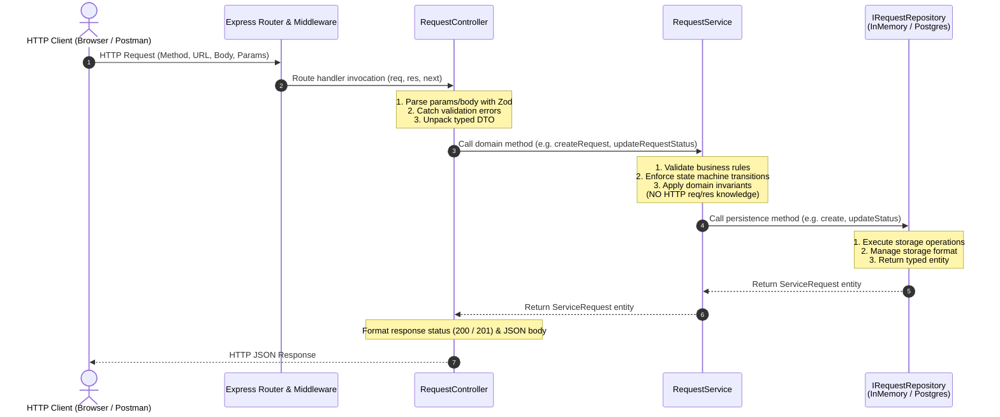

# Layer Responsibilities & Architectural Isolation — Day 05

This document details the architectural boundaries, division of responsibilities, and isolation rationales for the three core layers of the **Service Request Management System** backend: the **Controller Layer**, the **Service Layer**, and the **Repository Layer**.

---

## 1. Architectural Overview & Request Pipeline

The backend is built as a **Modular Monolith** adhering to strict layered architecture principles. Requests flow unidirectionally through well-defined boundaries:

---

## 2. Deep-Dive: Layer Responsibilities & Boundary Invariants

### 2.1 The Controller Layer (`controller.ts`)

The Controller is the **HTTP transport adapter**. Its single responsibility is translating between the HTTP protocol world and the application's domain services.

#### Primary Responsibilities (What it OWNS):
- **HTTP Request Parsing:** Extracts path parameters (`req.params`), query parameters (`req.query`), and JSON body payloads (`req.body`).
- **Schema Validation & Parsing:** Executes Zod schemas (`createRequestSchema`, `listRequestsQuerySchema`, `requestIdParamSchema`, `updateStatusSchema`) to guarantee inputs are structurally sound before domain execution.
- **Service Orchestration:** Invokes appropriate methods on the domain service with strongly-typed arguments.
- **HTTP Response Formatting:** Determines and sets appropriate HTTP status codes (`200 OK`, `201 Created`) and serializes domain objects into JSON.
- **Error Forwarding:** Catches exceptions during validation or service execution and delegates them to the centralized Express `next(error)` pipeline.

#### Architectural Boundaries (What it must NEVER do):
- **NEVER execute business logic:** It must not know that a newly created ticket starts in `'OPEN'` status, or what status transitions are allowed.
- **NEVER access data storage directly:** It must never import or call the repository directly, nor execute database queries.
- **NEVER manage transactions or domain entities directly:** It treats domain services as a black box.

---

### 2.2 The Service Layer (`service.ts`)

The Service encapsulates the **core business logic, workflows, and domain rules** of the application. It represents the use-cases of the system.

#### Primary Responsibilities (What it OWNS):
- **Domain Invariant Enforcement:** Enforces business invariants (e.g., all newly created service requests must initialize with status `'OPEN'`).
- **State Machine Transitions:** Authoritatively validates lifecycle status changes against `ALLOWED_STATUS_TRANSITIONS` (`OPEN` $\rightarrow$ `IN_PROGRESS` $\rightarrow$ `RESOLVED` $\rightarrow$ `CLOSED`).
- **Domain Error Dispatch:** Throws typed domain exceptions (`NotFoundError` with HTTP 404 semantics, `ValidationError` with HTTP 400 semantics and machine-readable error codes like `INVALID_STATUS_TRANSITION`).
- **Persistence Coordination:** Calls repository methods through dependency-injected interfaces (`IRequestRepository`).

#### Architectural Boundaries (What it must NEVER do):
- **NEVER import Express types:** It has zero knowledge of `Request`, `Response`, `NextFunction`, headers, cookies, or HTTP verbs.
- **NEVER format HTTP status codes or envelopes:** It does not return `{ status: 200 }` or JSON response wrappers.
- **NEVER execute SQL or storage-specific queries:** It communicates purely via abstract domain interfaces (`IRequestRepository`).

---

### 2.3 The Repository Layer (`repository.ts`)

The Repository mediates between the domain service layer and data persistence mechanisms. It acts as an **in-memory collection or database gateway** for domain entities.

#### Primary Responsibilities (What it OWNS):
- **Data Persistence & Retrieval:** Performs `create`, `findAll`, `findById`, and `updateStatus` operations.
- **Identity & Timestamp Generation:** Assigns unique identifiers (`crypto.randomUUID()`) and tracks timestamps (`created_at`, `updated_at`).
- **Collection Ordering & Filtering:** Implements query-level filtering (e.g. status filter) and default ordering (e.g. `created_at` descending, newest first).
- **Interface Segregation:** Exposes a contract-first interface (`IRequestRepository`) decoupled from the concrete storage engine.

#### Architectural Boundaries (What it must NEVER do):
- **NEVER validate business rules:** It does not decide if a status transition from `'OPEN'` to `'CLOSED'` is legitimate; it merely updates the record when instructed by the service.
- **NEVER know about HTTP:** It does not understand query strings, path parameters, or HTTP request contexts.
- **NEVER format output for UI consumption:** It returns raw, strongly-typed domain model instances (`ServiceRequest`).

---

## 3. Why Strict Layer Isolation Matters

### 3.1 Painless Swappability (In-Memory to PostgreSQL)
Because `RequestService` depends exclusively on the `IRequestRepository` interface:
- **Day 05 Implementation:** Uses `InMemoryRequestRepository` using JavaScript `Map` and `node:crypto`. The backend API runs and passes complete verification without a running PostgreSQL daemon.
- **Day 06 Transition:** When implementing PostgreSQL and database connection pooling, we simply write `PostgresRequestRepository implements IRequestRepository` and inject it into `RequestService`. **Zero lines of controller or service business logic need to change.**

### 3.2 Granular Unit & Integration Testing
- **Service Unit Tests:** We can instantiate `RequestService` with a lightweight mock repository in memory, verifying all 16 state transition permutations in milliseconds without spinning up an HTTP server or database container.
- **Controller Integration Tests:** Controllers can be tested using `supertest` with mock services to verify HTTP status codes, header parsing, and Zod error formatting in complete isolation.

### 3.3 Security, Integrity & Single Source of Truth
- Input validation at the controller layer halts malformed payloads (e.g. empty titles, non-UUID route parameters) at the door before CPU cycles are spent in the service or database layers.
- The service layer guarantees that data corruption (such as an illegal skip from `OPEN` to `RESOLVED`) is strictly prohibited, regardless of whether the request originated from the web frontend, a future CLI tool, or an internal administrative job.

---

## 4. Layer Responsibility Matrix

| Feature / Responsibility | Controller (`controller.ts`) | Service (`service.ts`) | Repository (`repository.ts`) |
| :--- | :---: | :---: | :---: |
| Parses `req.params.id` | **YES** | NO | NO |
| Validates UUID v4 format | **YES** (Zod) | NO | NO |
| Enforces initial status `'OPEN'` | NO | **YES** | NO |
| Validates `OPEN -> IN_PROGRESS` | NO | **YES** | NO |
| Throws `INVALID_STATUS_TRANSITION` | NO | **YES** | NO |
| Generates UUID & ISO timestamp | NO | NO | **YES** |
| Sorts requests newest-first | NO | NO | **YES** |
| Emits HTTP `200` or `201` | **YES** | NO | NO |
| Knows about Express `req` / `res` | **YES** | **NEVER** | **NEVER** |
| Knows about Database / Map storage | NO | NO | **YES** |
