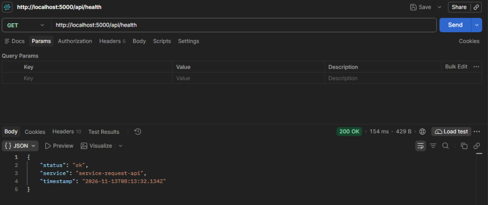
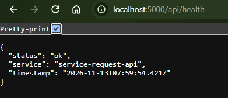
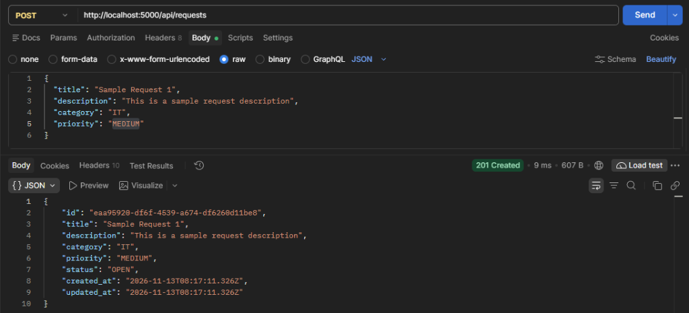
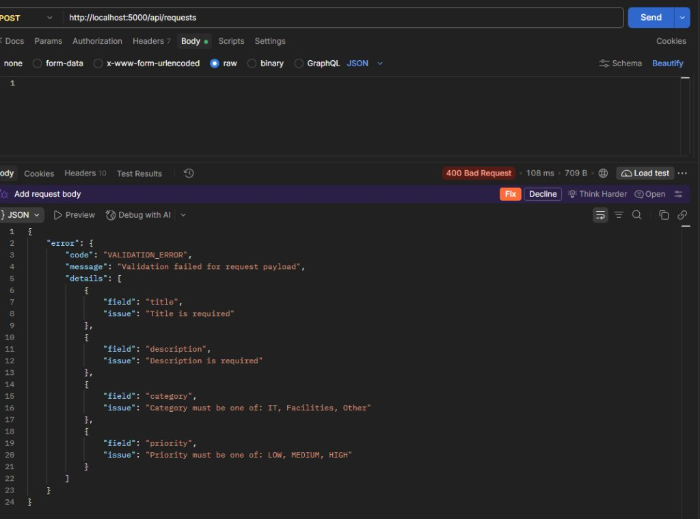
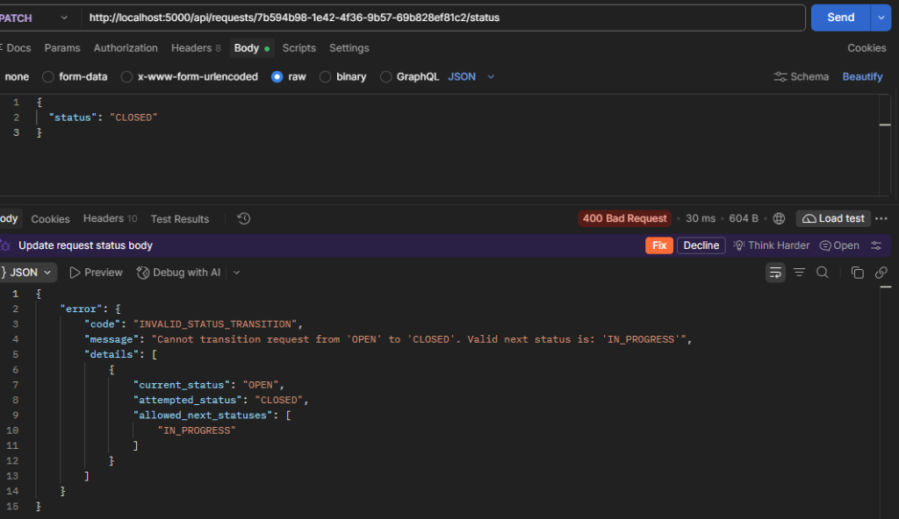

# Day 05 Backend API Verification Screenshots

This directory contains visual HTTP verification screenshots of the Day 05 Express.js & TypeScript Backend API implementation captured via Postman and web browser:

---

### 1. Health Check Endpoint — Postman (`GET /api/health`)
Verifies HTTP `200 OK` status and health metadata `{ "status": "ok", "service": "service-request-api", "timestamp": "..." }`.

---

### 2. Health Check Endpoint — Browser (`GET /api/health`)
Verifies direct browser access to the health endpoint with formatted JSON output.

---

### 3. Create Service Request — Postman (`POST /api/requests`)
Submits a valid service request (`Sample Request 1`). The service layer authoritatively defaults `status` to `'OPEN'` and generates a UUID and UTC timestamps, returning HTTP `201 Created`.

---

### 4. Schema Validation Error — Postman (`POST /api/requests`)
Submits an empty request payload. Zod schema intercepts the request and the centralized error middleware returns HTTP `400 Bad Request` with structured error details (`VALIDATION_ERROR`, missing required fields).

---

### 5. Disallowed Status Transition — Postman (`PATCH /api/requests/:id/status`)
Attempts an illegal direct lifecycle jump from `OPEN` to `CLOSED`. The domain state machine in `RequestService` halts the mutation and returns HTTP `400 Bad Request` with `INVALID_STATUS_TRANSITION` and valid next status guidance (`IN_PROGRESS`).

