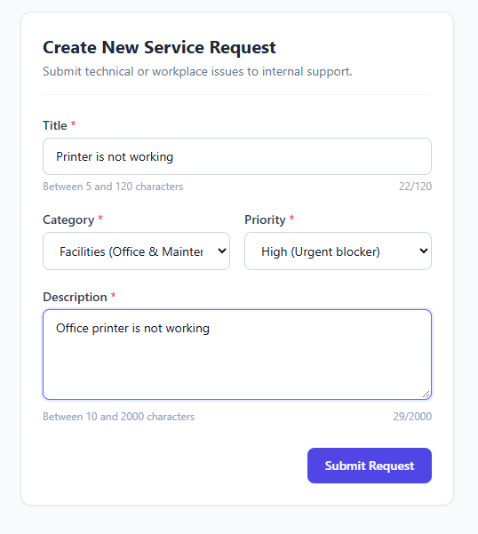
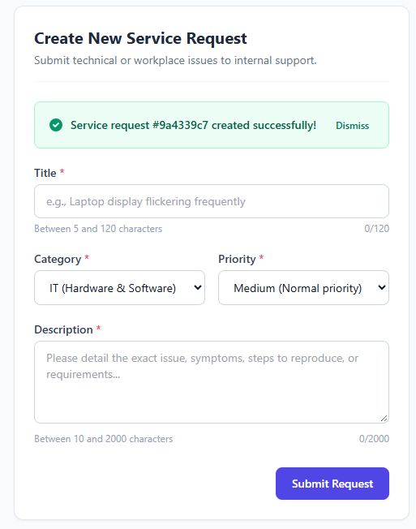
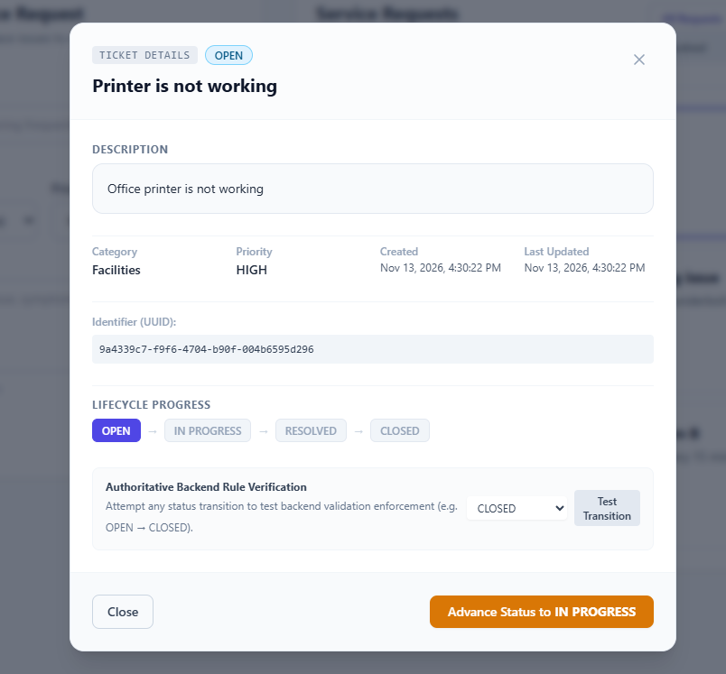
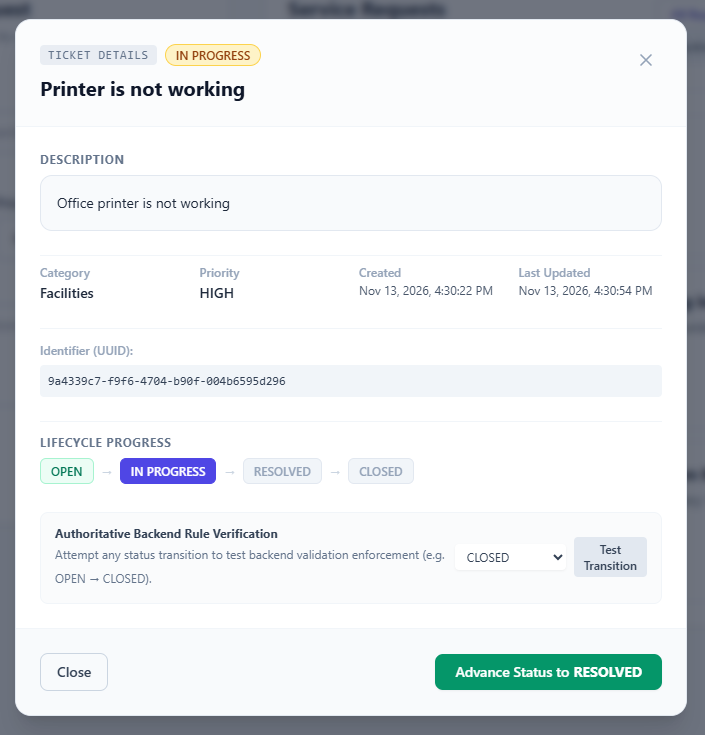
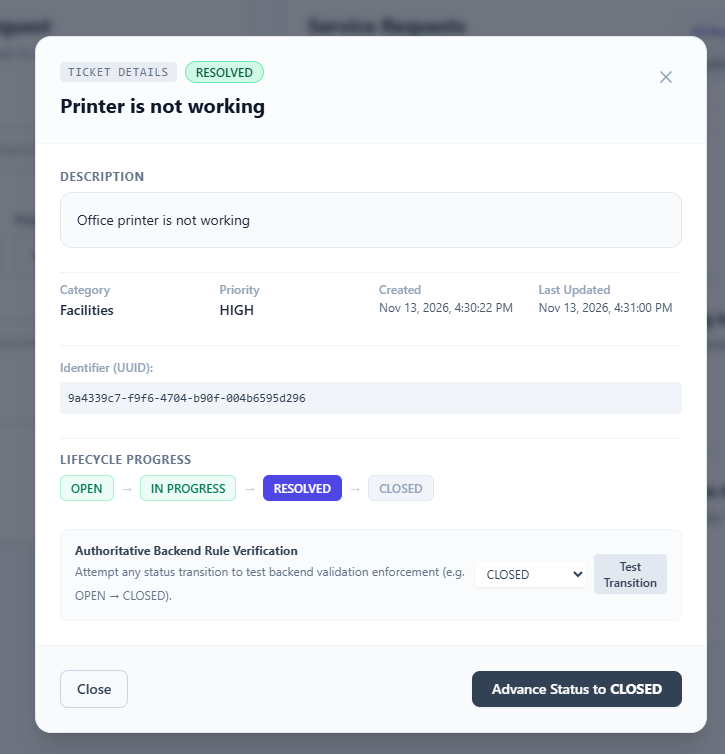
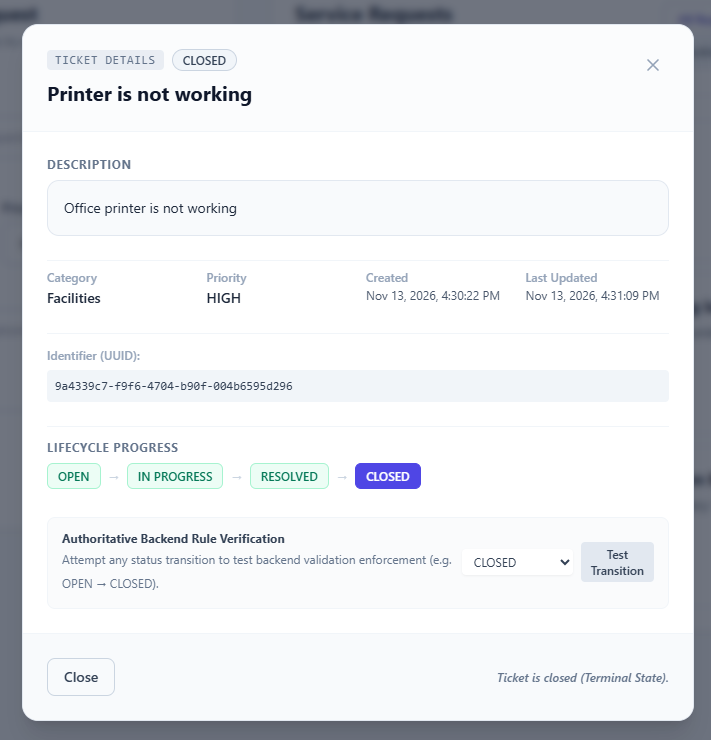
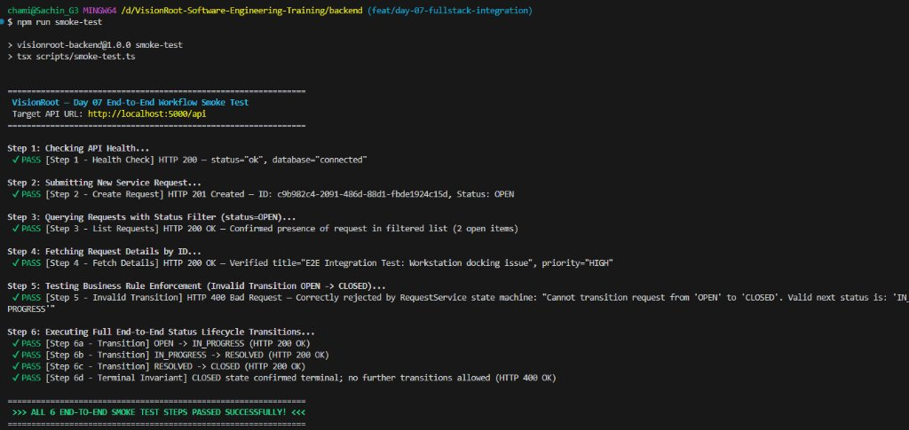

# Day 07 Full-Stack Integration & Business Workflow Screenshots

This directory preserves visual evidence of the Day 07 full-stack integration between the Next.js frontend UI, Express + TypeScript backend API, and PostgreSQL persistence layer:

---

### 1. Create Service Request Form (`POST /api/requests`)
Submitting a technical service request ("Printer is not working", Category: Facilities, Priority: High) via the Next.js client form.

---

### 2. Request Created Successfully (`HTTP 201 Created`)
The backend persists the ticket to PostgreSQL, assigns initial status `OPEN` and a UUID (`#9a4339c7`), and the frontend displays the success alert banner.

---

### 3. Ticket Details Modal — Status `OPEN` (`GET /api/requests/:id`)
Modal fetches live ticket details from the backend, displays UUID `9a4339c7-...`, marks `OPEN` as active on the lifecycle progress indicator, and offers the action button **"Advance Status to IN PROGRESS"**.

---

### 4. Ticket Details Modal — Status `IN_PROGRESS` (`PATCH /api/requests/:id/status`)
Advancing the ticket via `PATCH` to `IN_PROGRESS`. The UI updates immediately on `200 OK`, timestamp is refreshed, and the button transitions to **"Advance Status to RESOLVED"**.

---

### 5. Ticket Details Modal — Status `RESOLVED` (`PATCH /api/requests/:id/status`)
Advancing the ticket via `PATCH` to `RESOLVED`. Lifecycle indicator reflects completion through `RESOLVED`, and the button transitions to **"Advance Status to CLOSED"**.

---

### 6. Ticket Details Modal — Status `CLOSED` (Terminal State)
Final transition via `PATCH` to `CLOSED`. The ticket reaches its terminal state, and the action button changes to informational text: *"Ticket is closed (Terminal State)."*

---

### 7. End-to-End Workflow Smoke-Test Terminal Execution
Automated execution of `npm run smoke-test` on branch `feat/day-07-fullstack-integration` executing all 6 verification steps against the live Express + PostgreSQL API server:
- Step 1: Health check (`HTTP 200`, database: "connected")
- Step 2: Request creation (`HTTP 201 Created`, status: OPEN)
- Step 3: Status-filtered query (`HTTP 200 OK`, created ID confirmed)
- Step 4: Details retrieval (`HTTP 200 OK`)
- Step 5: Invalid transition rejection (`HTTP 400 Bad Request`, `INVALID_STATUS_TRANSITION`)
- Step 6: Full sequential lifecycle (`OPEN` → `IN_PROGRESS` → `RESOLVED` → `CLOSED` → terminal invariant check)

